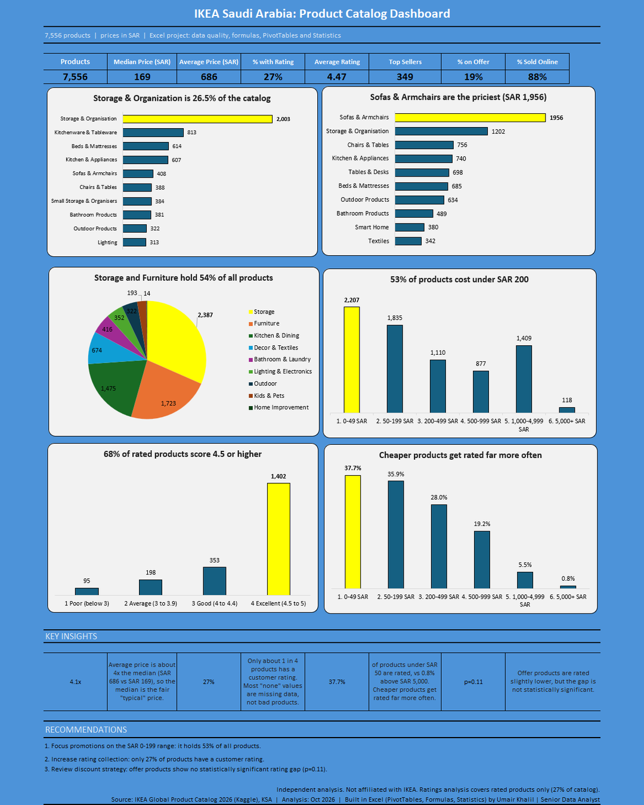

# IKEA Saudi Arabia Catalog Analysis

**Data Cleaning, Statistics, and an Excel Dashboard** | Excel, Power Query, PivotTables


I cleaned 7,556 IKEA Saudi Arabia products, tested what goes with ratings and top-seller status, and turned it into a one-page Excel dashboard.

## 

## Dashboard Preview



## 

## Business Questions

1. What does the catalog contain, and which categories matter most?
2. How are prices spread, and does the average tell the real story?
3. What goes with ratings and top-seller status: price, offers, or category?

## 

## Dataset

[IKEA Global Product Catalog (46 Countries) - 2026](https://www.kaggle.com/datasets/ranjithpanicker/ikea-global-product-catalog-and-price-2026) on Kaggle, Saudi Arabia (KSA) rows: 7,556 products and 19 raw columns, prices in SAR. The file has no sales, quantity or date columns, so the analysis describes the catalog, not sales.

## 

## Approach

1. **Audit:** a live-formula sheet ran 17 data quality checks on the untouched raw data.
2. **Clean:** one Power Query script fixed IDs, broken letters, "none" values, constant columns, and repeats on refresh.
3. **Summarise:** Excel formulas (COUNTIF, AVERAGEIF, SUMPRODUCT) and 5 PivotTables.
4. **Test:** Welch t-test, two-proportion z-test, chi-square test, correlation and regression.
5. **Present:** an Excel dashboard with KPI cards, six charts, key insights and recommendations.

## 

## Key Findings

* 6,846 of 7,556 rows (90.6%) had at least one data gap, so cleaning came before charting.
* Storage and Furniture make up 54% of the catalog; Storage \& Organisation alone is 26.5%.
* The median price is SAR 169, and the average is SAR 686 (4.1 times higher), so the median is the typical price. 53% of products cost under SAR 200.
* Only 27% of products have a rating. Cheaper products are rated far more often: 37.7% under SAR 50 against 0.8% above SAR 5,000 (chi-square p < 0.001).
* Offers do not change ratings (p = 0.109), but offer products are Top Sellers less often: 3.6% against 5.5% (p = 0.003).
* 45.3% of ratings are exactly 5.0, and 599 rated products have a single review, so a weighted rating is a fairer way to rank products.

## 

## Recommendations

* Rank products by weighted rating, not the raw score.
* Increase rating collection, starting with products above SAR 200.
* Review the offer strategy and add sales data to explain why offer products are Top Sellers less often.
* Focus promotions on the SAR 0-199 range and report the median as the typical price.

## 

## Limits

* Ratings cover only 27% of products.
* The catalog is not a randomised experiment, so the tests show differences, not causes.
* No sales or date data, so revenue and trends cannot be measured.

## 

## Tools and Skills

**Tools:** Microsoft Excel, Power Query, Excel Formulas, PivotTables, Statistical Analysis

**Skills:** Data Cleaning, Data Analysis, Statistical Testing, Data Visualization, Dashboard Design, Data Storytelling

## 

## Repository Structure

​```

ikea-ksa-catalog-analysis/
├── README.md
├── IKEA_Dashboard.png                       (dashboard image)
└── IKEA_Catalog_Analysis_Case_Study_Final.pdf   (case study PDF)
​```

## 

## Author

Umair Khalil | Senior Data Analyst

## 

## Disclaimer

Independent analysis, not affiliated with IKEA. Data: [IKEA Global Product Catalog 2026 (Kaggle)](https://www.kaggle.com/datasets/ranjithpanicker/ikea-global-product-catalog-and-price-2026), KSA rows. Dataset credit to its Kaggle uploader.

